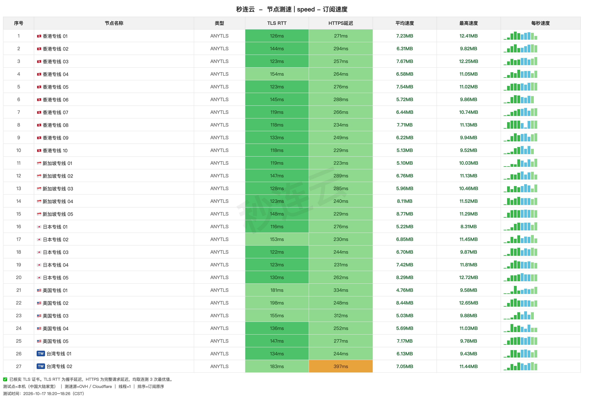
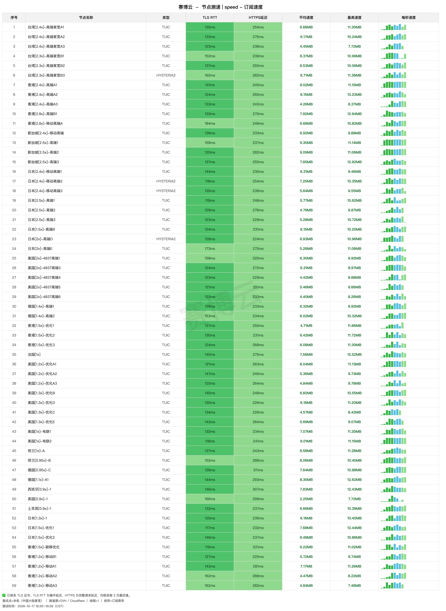

# 机场推荐（2026-10-18 更新）

> **[秒连云](https://github.com/REPLACE_OWNER/miaolianyun-jichang)** — 稳，全节点连通 · **[官网注册](https://mly518.com/#/register?code=IDN5bnoG)**
>
> **[赛博云](https://github.com/REPLACE_OWNER/saiboyun-jichang)** — 便宜，量大 · **[官网注册](https://saiboyun.org/#/register?code=dAvrmHqg)**
>
> **[赔钱机场](https://github.com/REPLACE_OWNER/peiqian-jichang)** — 0.1 倍节点，流量翻十倍 · **[官网注册](https://xn--mes358aby2apfg.com/register?code=qhyiSP1G&cover=sfw)**
>

| | |
|---|---|
| 收录 | 3 家自用机场 |
| 起步价 | 3 元/月起 |
| 实测 | 全节点测速，每节点连测 3 次取最优 |
| 更新 | 价格随官网变，节点按周复测 |

## 对比

| 机场 | 起步价 | 对应套餐 | 每元流量 | 本次测速 | 延迟中位 | 速度中位 | 实测最快 |
|---|---|---|---|---|---|---|---|
| **[秒连云](https://github.com/REPLACE_OWNER/miaolianyun-jichang)** | 8 元/月 120G | Air 120G | 19 GB/元 | 27/27 | 133ms | 6.7 MB/s | **8.8 MB/s** |
| **[赛博云](https://github.com/REPLACE_OWNER/saiboyun-jichang)** | 3 元/月 120G | 轻量套餐 | 74 GB/元 | 59 节点连通 | 134ms | 6.3 MB/s | **9.3 MB/s** |
| **[赔钱机场](https://github.com/REPLACE_OWNER/peiqian-jichang)** | 1.5 元/月 100G | 一瓶盖可乐 | 500 GB/元 | 26 节点连通 | 154ms | 6.5 MB/s | **9.2 MB/s** |

## 三家详细测评

### 秒连云（8 元/月 120G）

**一句话评价：省心之选：全部节点连通、1 倍计费无套路，导入即用**

- **8 元/月 120G 起**，全套餐统一 160 Mbps——升档只加流量不加速度，从最低档开始就行
- **27 个节点本次全部连通**，延迟中位 133ms；香港 10 / 新加坡 5 / 日本 5 / 美国 5 / 台湾 2
- 港新日延迟 116–154ms，节点平均速度最高 8.8 MB/s（新加坡专线 05）
- 全部 1 倍计费，没有倍率套路；AnyTLS 协议
- 适合不想挑节点、导入即用的人；8 元档先试，不够再升

**适合：**

- 第一次买机场，想先用最低档试试
- 不想挑节点，导入就能用
- 看视频追剧（港新日延迟 116–154ms）

#### 秒连云 套餐

| 套餐 | 流量 | 设备 | 限速 | 一次付 | 月付 | 季付 | 半年 | 年付 | 两年 | 三年 |
|---|---|---|---|---|---|---|---|---|---|---|
| 150G/月 年付活动 | 150G | — | 160M | — | — | — | — | 118 | — | — |
| 220G/月 年付活动 | 220G | — | 160M | — | — | — | — | 168 | — | — |
| Air 120G | 120G | — | 160M | — | **8 元** | 24 | 48 | 96 | — | — |
| Base 220G | 220G | — | 160M | — | **15 元** | 45 | 90 | 180 | — | — |
| Pro 320G | 320G | — | 160M | — | **22 元** | 66 | 132 | 262 | — | — |
| Max 520G | 520G | — | 160M | — | **28 元** | 82 | 162 | 320 | — | — |
| 120G不限时 | 120G 一次性 | — | 160M | **38 元** | — | — | — | — | — | — |
| 320G不限时 | 320G 一次性 | — | 160M | **78 元** | — | — | — | — | — | — |
| 980G不限时 | 980G 一次性 | — | 160M | **198 元** | — | — | — | — | — | — |

> 全套餐统一 160 Mbps 限速，升档只加流量不加速度。年付活动为单独商品，不走档位折扣。

#### 秒连云 测速

本次 全部 27 节点连通：节点平均速度最高 8.8 MB/s，每节点连测 3 次取最优。

| 节点 | 协议 | 延迟 | 完整请求 | 平均速度 | 最高速度 |
|---|---|---|---|---|---|
| 🇸🇬新加坡专线 05 | ANYTLS | 148ms | 229ms | **8.77 MB/s** | 11.29 MB/s |
| 🇺🇸美国专线 02 | ANYTLS | 198ms | 248ms | **8.44 MB/s** | 12.65 MB/s |
| 🇯🇵日本专线 05 | ANYTLS | 130ms | 262ms | **8.29 MB/s** | 12.72 MB/s |
| 🇸🇬新加坡专线 04 | ANYTLS | 123ms | 240ms | **8.11 MB/s** | 11.52 MB/s |
| 🇭🇰香港专线 08 | ANYTLS | 118ms | 234ms | **7.71 MB/s** | 11.13 MB/s |
| 🇭🇰香港专线 03 | ANYTLS | 123ms | 257ms | **7.67 MB/s** | 12.25 MB/s |
| 🇭🇰香港专线 05 | ANYTLS | 123ms | 276ms | **7.54 MB/s** | 11.02 MB/s |
| 🇯🇵日本专线 04 | ANYTLS | 123ms | 231ms | **7.42 MB/s** | 11.81 MB/s |

*逐节点原始数据见 `data/`。*

**[官网注册](https://mly518.com/#/register?code=IDN5bnoG)** · **[完整测评](https://github.com/REPLACE_OWNER/miaolianyun-jichang)**

### 赛博云（3 元/月 120G）

**一句话评价：便宜量大之选：3 元 120G 起，按量付费不清零，16 档随便挑**

- **3 元/月 120G 起**——三家里起步价最低；按量付费不清零：100G 8 元 / 500G 38 元 / 1000G 68 元
- **59/62 节点连通**，覆盖 11 个地区（美国 15 / 香港 13 / 日本 12 / 台湾 7 / 新加坡 5 / 欧洲 9）
- 限速随档位给足：3 元档 70M → 12 元档 300M → 28 元档 500M；3 元档就有 5 台设备
- 每元流量最高 74 GB/元，月付三家里单价最低
- 节点带 0.9x–2.8x 倍率：流量敏感选 0.9x/1x 节点，额度全额可用

**适合：**

- 预算有限，对价格敏感
- 流量消耗大，想要按量付费包
- 多设备共用（3 元档就有 5 台）

#### 赛博云 套餐

| 套餐 | 流量 | 设备 | 限速 | 一次付 | 月付 | 季付 | 半年 | 年付 | 两年 | 三年 |
|---|---|---|---|---|---|---|---|---|---|---|
| 轻量套餐 | 120G | 5 | 60M | — | **3 元** | 8.65 | 16.50 | 30 | 57 | 81 |
| 入门套餐 | 320G | 6 | 150M | — | **6 元** | 17.50 | 33 | 60 | 114 | 162 |
| 基础套餐 | 520G | 7 | 200M | — | **9 元** | 25.90 | 49.50 | 90 | 171 | 243 |
| 进阶套餐 | 750G | 9 | 300M | — | **12 元** | 34.50 | 66 | 120 | 228 | 324 |
| 高级套餐 | 1066G | 11 | 400M | — | **16 元** | 46 | 88 | 160 | 304 | 432 |
| 豪华套餐 | 2077G | 16 | 500M | — | **28 元** | 81 | 154 | 280 | 532 | 756 |
| 超级套餐 | 3088G | 22 | 不限 | — | **42 元** | 121 | 231 | 420 | 798 | 1134 |
| 究极套餐 | 5099G | 27 | 不限 | — | **69 元** | 198 | 379 | 690 | 1311 | 1863 |
| 按量付费100G | 100G 一次性 | — | 150M | **8 元** | — | — | — | — | — | — |
| 按量付费500G | 500G 一次性 | — | 200M | **38 元** | — | — | — | — | — | — |
| 按量付费1000G | 1000G 一次性 | — | 300M | **68 元** | — | — | — | — | — | — |
| 按量付费2000G | 2000G 一次性 | — | 400M | **128 元** | — | — | — | — | — | — |
| 按量付费5000G | 5000G 一次性 | — | 不限 | **298 元** | — | — | — | — | — | — |
| 奈飞体验套餐:Netflix五人车+320G流量 | 320G | 14 | 不限 | — | — | 104 | 206 | — | — | — |
| 奈飞轻量套餐:Netflix五人车+520G流量 | 520G | 16 | 不限 | — | — | 112 | 222 | — | — | — |
| 奈飞高级套餐:Netflix五人车+1066G流量 | 1066G | 18 | 不限 | — | — | 131 | 260 | — | — | — |

> 限速随套餐档位递增；42 元及以上两档官网未标注限速。

#### 赛博云 测速

本次 连通 59 / 共 62 节点：节点平均速度最高 9.3 MB/s，每节点连测 3 次取最优。

| 节点 | 协议 | 延迟 | 完整请求 | 平均速度 | 最高速度 |
|---|---|---|---|---|---|
| 新加坡[2.5x]-高端1 | TUIC | 159ms | 237ms | **9.30 MB/s** | 11.14 MB/s |
| 新加坡[2.5x]-高端2 | TUIC | 120ms | 282ms | **9.09 MB/s** | 11.06 MB/s |
| 香港[2.4x]-高端A1 | TUIC | 141ms | 245ms | **9.02 MB/s** | 11.10 MB/s |
| 美国[1x]-电联2 | TUIC | 118ms | 241ms | **9.01 MB/s** | 11.15 MB/s |
| 德国[1.1x]-A1 | TUIC | 144ms | 293ms | **8.35 MB/s** | 12.62 MB/s |
| 香港[2.4x]-高端A2 | TUIC | 124ms | 260ms | **8.15 MB/s** | 13.23 MB/s |
| 荷兰[0.95x]-B | TUIC | 152ms | 286ms | **8.06 MB/s** | 10.40 MB/s |
| 美国[1.2x]-优化A1 | TUIC | 121ms | 263ms | **8.04 MB/s** | 11.13 MB/s |

*逐节点原始数据见 `data/`。*

**[官网注册](https://saiboyun.org/#/register?code=dAvrmHqg)** · **[完整测评](https://github.com/REPLACE_OWNER/saiboyun-jichang)**

### 赔钱机场（1.5 元/月 100G）

**一句话评价：重度用户之选：0.1 倍节点额度翻 10 倍，最大单档 20TB**

- **1.5 元/月 100G 起**，中瓶 2.99 元 500G——**每元 167 GB，三家里最耐用的额度**
- **12 个 0.1 倍节点**：走这类节点实际传输 10GB 只扣 1G，100G 额度当 1000G 用
- 83 个节点规模最大：美国 32 / 日本 20 / 香港 11 / 新加坡 9；本次连通 26 个，最快 9.2 MB/s
- 0.1 倍节点集中在美区，大流量下载/挂PT的用武之地
- 月流量每日限用 20%（公平使用）；节点名带「三网推荐」按运营商挑

**适合：**

- 大流量下载、挂 PT、频繁看 4K
- 认准 0.1 倍率：同样额度实际能传 10 倍数据
- 美区用户（0.1 倍节点集中在美区）

#### 赔钱机场 套餐

| 套餐 | 流量 | 设备 | 限速 | 一次付 | 月付 | 季付 | 半年 | 年付 | 两年 | 三年 |
|---|---|---|---|---|---|---|---|---|---|---|
| 大瓶可乐 | 1000G | 20 | 不限 | — | **5.99 元** | — | 34.99 | 68.99 | 133.99 | 199.99 |
| 超大瓶可乐 | 5000G | 30 | 不限 | — | **12.99 元** | — | 73.99 | 139.99 | 265.99 | 375.99 |
| 水桶可乐 | 20000G | 40 | 不限 | — | **39.99 元** | — | 225.99 | 429.99 | 810 | 1150.99 |
| 中瓶可乐 | 500G | 15 | 不限 | — | **2.99 元** | — | 17.99 | 34.99 | 68.99 | 99.99 |
| 一瓶盖可乐 | 100G | 10 | 不限 | — | **1.50 元** | — | 9 | 18 | 36 | 54 |
| 企业套餐(300台设备数量支持) | 99999G | 300 | 不限 | — | **280 元** | 798 | 1515 | 2888 | 5488 | 8088 |
| 一会嗦一口(不限时长永久订阅) | 1000G 一次性 | 10 | 不限 | **18.90 元** | — | — | — | — | — | — |
| 一会嗦(不限时长永久订阅) | 4000G 一次性 | 20 | 不限 | **68.90 元** | — | — | — | — | — | — |
| 一大口(不限时长永久订阅) | 6000G 一次性 | 30 | 不限 | **88.99 元** | — | — | — | — | — | — |
| 至尊订阅(不限时长永久订阅) | 20000G 一次性 | 40 | 不限 | **228.80 元** | — | — | — | — | — | — |
| 顶级王冠99999GB流量订阅(不限时长永久订阅) | 99999G 一次性 | 300 | 不限 | **688 元** | — | — | — | — | — | — |

> 月流量按 20% 用量限速为「每天流量限制为总的20%」的公平使用；0.1 倍节点计入同额度，实际可用量约为标称 10 倍。

#### 赔钱机场 测速

本次 连通 26 / 共 83 节点：节点平均速度最高 9.2 MB/s，每节点连测 3 次取最优。

| 节点 | 协议 | 延迟 | 完整请求 | 平均速度 | 最高速度 |
|---|---|---|---|---|---|
| 🇺🇸美国圣何塞05-0.1倍 | VLESS | 152ms | 223ms | **9.15 MB/s** | 11.14 MB/s |
| 🇺🇸美国07-0.1倍 \| 电信联通移动推荐 | HYSTERIA2 | 149ms | 280ms | **8.92 MB/s** | 11.15 MB/s |
| 🇺🇸美国洛杉矶08-0.1倍 | VLESS | 151ms | 292ms | **8.34 MB/s** | 11.60 MB/s |
| 🇺🇸美国圣何塞01-0.1倍 | VLESS | 177ms | 308ms | **7.91 MB/s** | 10.87 MB/s |
| 🇺🇸美国洛杉矶08 \| 三网推荐 | VLESS | 158ms | 261ms | **7.58 MB/s** | 12.01 MB/s |
| 🇯🇵日本东京07 \| 高速专线推荐 | VLESS | 165ms | 262ms | **7.54 MB/s** | 12.35 MB/s |
| 🇺🇸美国02-0.1倍 \| 电信联通移动推荐 | HYSTERIA2 | 184ms | 254ms | **7.52 MB/s** | 10.97 MB/s |
| 🇺🇸美国圣何塞03-0.1倍 | VLESS | 186ms | 264ms | **7.15 MB/s** | 11.66 MB/s |

*逐节点原始数据见 `data/`。*

**[官网注册](https://xn--mes358aby2apfg.com/register?code=qhyiSP1G&cover=sfw)** · **[完整测评](https://github.com/REPLACE_OWNER/peiqian-jichang)**

## 买之前要知道

- 机场都会有线路波动，建议月付起步，用顺了再考虑年付
- 认准计费倍率再下单：同样额度，0.1x 节点能当 10 份用，2.8x 节点只值四成
- 长期使用建议留一家备用机场，避免单点失联

## 怎么选

- **第一次买 / 想省心** → 秒连云。27 节点全连通、1 倍计费零套路，8 元/月先试。
- **预算优先** → 赛博云。3 元 120G 起步、按量包不清零，低倍率节点全额可用。
- **已有机场、要大流量** → 赔钱机场。0.1 倍节点额度翻十倍，39.99 元 20000G 是三家里最大的单档额度。

## 说明

- 三家均为自用订阅，排序按实测数据。
- 价格取自官网接口，节点每周复测，页头为最近一次复测日期。

## 更新

- **2026-10-18** — 三家套餐价格复核（官网接口），节点数据例行检查，无变化。

---
*测速 2026-10-17 18:20–18:26，中国大陆家宽出口香港，每节点连测 3 次取最优。*

更多机场测评

- [秒连云 测评](https://github.com/REPLACE_OWNER/miaolianyun-jichang)
- [赛博云 测评](https://github.com/REPLACE_OWNER/saiboyun-jichang)
- [赔钱机场 测评](https://github.com/REPLACE_OWNER/peiqian-jichang)

